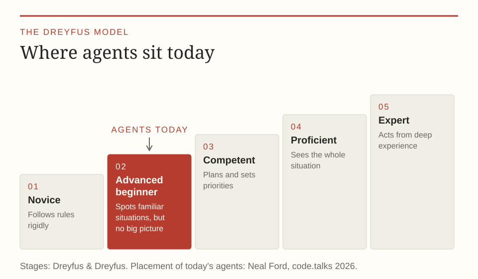
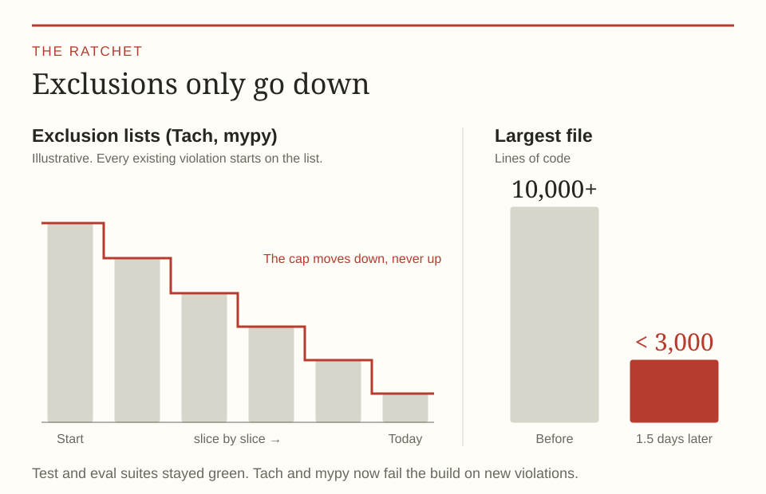

This week I heard people on a client team say they'd rather delete a 10,000-line Python file than touch it. An agent had written it, with tests and a spec. After a day and a half of focused work with an agent, that file was under 3,000 lines. Same kind of agent, very different result. The difference was the constraints around it, and someone who owned the design and chose them.

That contrast sums up something that's been on my mind all year: expectations. So before task recipes, the next layer of the factory after [Part III](/software-factory-part-3-adaptive-goal/), I'm taking a short detour. This year I've talked to a lot of developers who have played with AI coding tools, and read a lot of loud opinions on LinkedIn and elsewhere. What people expect from coding agents is often far from how the heaviest users actually work with them, and the gap is bigger than I thought.

Here's my take, borrowing a term from people I learned from this year. Left unconstrained, coding agents are entropy machines. The people getting the best results constrain them hard, and I've stopped doubting that they're right about this.

## Where I started

If you've read my earlier posts, you know where I stood at the beginning of the year. An agent is a pattern-matching machine at heart. It looks at your codebase to figure out how things are done and does more of the same, including your worst patterns, and it does that fast. So code quality matters a lot, as I argued in [On Boilerplate and the Death of Old Principles](/on-boilerplate-and-the-death-of-old-principles/).

What I learned later in the year is that a good codebase isn't enough either. If agents are supposed to succeed in the medium to long term, you need to shepherd them with even harder guidance and even more deterministic checks than I initially thought. By deterministic checks I mean things like tests, type checkers, and linters that give the same answer every time, no matter what the agent intended.

## What if I'm wrong?

What stuns me on LinkedIn is how often very vocal people claim that agents are on an exponential capability curve. According to them, it's only a matter of time until none of this matters. Stop caring about code quality. Stop building guardrails. Leave the agents alone. Some of them say, almost proudly, that they don't look at the code anymore, and don't care how it's designed. Given where LLMs are today, that position makes me deeply uncomfortable. Maybe agents get there one day. Until then, a lot of slop gets produced, and humans are still accountable when things go wrong. You can't hide behind an agent. "The agent wrote it, I don't know" isn't an answer I'd accept from an engineer.

Still, somewhere this year I started to wonder whether I had this wrong. It doesn't help that the conversation is so loud. One group says don't bother, it'll fix itself in a couple of months. Others, like Mario Zechner, who created the Pi coding agent, tell you to [slow the fuck down](https://mariozechner.at/posts/2026-03-25-thoughts-on-slowing-the-fuck-down/). I've stolen that phrase more than once.

So I paid closer attention. I went to conferences, attended trainings with some extremely proficient people in this space, and looked carefully at how their setups work. I know that sample isn't neutral. Most of the people I learned from already lean my way.

The curve itself is real. [METR measures](https://metr.org/time-horizons/) the length of tasks frontier models can complete about half the time, and that length keeps doubling every few months. I'm not going to argue with that. What I don't see is that curve turning into well-designed code on real, messy codebases when nobody constrains the agent. Benchmark tasks are clean. Codebases with years of history aren't. Whatever the trajectory, I build for the models we have today. And if they keep getting better, the deterministic checks I put around them don't become useless. They catch mistakes from any author, human or agent.

What would change my mind is a team that leaves its agents unconstrained on a large, long-lived codebase, and whose design stays healthy for a year or more. I haven't seen one yet.

## Tactical specialists

At [code.talks](https://codetalks.com/) this year, I listened to Neal Ford, formerly of Thoughtworks, talk about how to constrain an agent so it does the right thing. He wrote the architecture down, in decision records or in a language for describing architectural constraints. Then he enforced it with tools like [ArchUnit](https://www.archunit.org/). His reasoning was simple. Agents don't care much about architecture. They are very, very willing to get the job done.

Matt Pocock made the same point in his [software factory cohort](https://www.aihero.dev/cohorts/software-factories-for-real-engineers-xdy1m), which I'm about to finish. Agents are tactical specialists, not strategic ones.

That matches what I see. An agent will solve the problem in front of it in whatever way works for that one change. It won't stop and ask whether the solution breaks a module boundary your team spent two years establishing.

Neal also compared today's frontier models with the [Dreyfus model of skill acquisition](https://en.wikipedia.org/wiki/Dreyfus_model_of_skill_acquisition), which describes five stages people go through on the way from novice to expert. In his comparison, agents are currently at the second stage, **advanced beginner**. An advanced beginner recognises situations they've seen before, but treats every aspect of a situation as equally important and doesn't see the big picture yet. Planning deliberately, setting priorities, and choosing what to focus on only come one stage later, with competence. I find that fascinating, and it lines up well with what I'm seeing. Agents can copy work and recombine existing work. On their own, they rarely zoom out and reason about it.

<figure>
  <picture>
    <source media="(max-width: 600px)" srcset="/assets/images/entropy-machines-dreyfus-mobile.svg" />
    
  </picture>
  <figcaption>Agents today: one step short of planning and prioritising on their own.</figcaption>
</figure>

Yes, with a lot of agents and a lot of money you can brute-force a problem. Many agents together can find new solutions by trying and recombining. But they're still bound by how the technology underneath works. LLMs have limited attention. They lose focus when there are too many things to pay attention to. They lose focus when their instructions conflict. All of that shows up in the result.

That's what I mean by **entropy machines**. Left alone, they create disorder. The agents aren't malicious or stupid. They're eager to finish the task, and nothing tells them when they've gone wrong.

## Ratcheting out of entropy

Here's what the opposite looks like in practice, from the client team I mentioned at the start.

The team had built a Python tool that sets up complex agent environments, partly in plain code and partly as instructions for an agent. Let's call it the bootstrapper. An agent had built it, with very high test and eval coverage and a written spec that was kept in sync with the code. So it wasn't vibe-coded or YOLOed, generated on autopilot and accepted without anyone checking. It was working software. Still, it was far from being in good shape. Its internal structure was a perfect example of entropy. One file in particular scared a couple of people on the team. It was more than 10,000 lines long, and nobody dared to refactor it. Having agents didn't make that fear go away. An agent still needs someone to give it a direction, and when nobody understands the code, nobody knows which direction makes it better.

Some wanted to delete the bootstrapper and start over. I get the impulse. If an agent wrote it from a spec, why not let an agent write it again? But software is rarely built in one shot, and the bootstrapper wasn't either. The spec grew over time, feature by feature, as the agent added things. It tracked what the tool does, not how it should be designed. Regenerating from it would most likely give you the same entropy, just arranged differently. Even with better checks from day one, you'd rediscover every edge case the tests and evals only partly capture, and pay for the whole thing a second time. Refactoring under constraints keeps what works and changes the conditions that produced the mess.

The cool thing about having agents at your disposal is that you can fix situations like this far more easily than before. You just need a few tricks.

The main one is what Neal Ford described with ArchUnit: an architecture linter. It defines which layers and packages inside the application may depend on each other, and fails the build when code crosses a boundary. It doesn't have to be perfect from the start. You'll probably begin with a long list of exclusions. Then you ratchet. Like the mechanism, it only turns one way. You tell the agent it isn't allowed to add new exclusions anymore, and you work with it step by step to remove the existing violations. The list can only get shorter. Matt Pocock shows this kind of ratchet in that cohort, using [dependency-cruiser](https://github.com/sverweij/dependency-cruiser) to enforce package boundaries in TypeScript.

This week I used [Tach](https://github.com/tach-org/tach), which does something very similar for Python. Here's roughly how it went:

1. Add Tach, with all of today's violations as exclusions. From then on, no new exclusions.
2. Do the same with [mypy](https://mypy-lang.org/) to turn untyped Python into typed Python. Modules that aren't fully typed yet go on an exclusion list, and that list can only shrink, too.
3. Work out with the agent how to split the refactoring into small, safe slices. I used a variant of Matt's [grill-with-docs](https://github.com/mattpocock/skills/blob/main/skills/engineering/grill-with-docs/SKILL.md) skill, which has the agent question you until the plan is clear. This is where most of my time went.
4. Let the agent carry out the slices, guided by Matt's [codebase-design](https://github.com/mattpocock/skills/blob/main/skills/engineering/codebase-design/SKILL.md) and [improve-codebase-architecture](https://github.com/mattpocock/skills/blob/main/skills/engineering/improve-codebase-architecture/SKILL.md) skills, removing violations and exclusions along the way. The test and eval suites are the safety net throughout.

The agent did most of the typing. The judgement about which constraints to set and how to slice the work was mine. That's the advanced beginner and the competent practitioner working together.

And guess what? At the time of writing, that 10,000-line file is down to fewer than 3,000 lines. The test and eval suites still pass, and we haven't found any regressions so far. The structure is much better, and Tach and mypy fail the build if anyone, human or agent, brings the old mess back. That's amazing. Not long ago this would have taken very proficient people a long time. Now it took a day and a half of focused work, because I knew the tools and the approaches. Whether it stays healthy is the real test, so ask me again in a year. That's the same bar I set for the other side.

<figure>
  <picture>
    <source media="(max-width: 600px)" srcset="/assets/images/entropy-machines-ratchet-mobile.svg" />
    
  </picture>
  <figcaption>The agent did the work. I chose the ratchet, and the ratchet keeps the work from sliding back.</figcaption>
</figure>

What does it look like at scale, with those constraints in place? Look at Lauren Tan, known as poteto, who works on Grok Bot at SpaceXSI. In her talk [How I Shipped 2000 PRs Last Month](https://www.youtube.com/watch?v=NjoZoUm85x0), she was at around 2,000 PRs a month. By her more recent AI Engineer talk, [All Code Is Slop (Except Mine)](https://ai.engineer/talks/O_zcc6Xl12g-all-code-is-slop-except-mine), she was at around 3,000. It's incredible. And by her own description, her agents write changes faster than she can read them.

She credits verification and the work on the codebase for that volume. As it rose, the share of reverted PRs fell and settled at about 0.5%. That doesn't count bugs fixed in a later PR, and it only says the changes work, not that the design is healthy. What speaks to the design is what her team built around the agents. They changed the structure of the codebase to make it friendlier to agents and to verification:

- Lint rules and a dependency analyser enforce boundaries.
- The guidance lives in lint messages, so the agent sees it exactly when it breaks a rule.
- Recurring review comments turn into checks, or into APIs that make the mistake hard to express.
- Agents drive the running app and save screenshots as evidence.
- They're experimenting with [TLA+](https://lamport.azurewebsites.net/tla/tla.html) and [Lean](https://lean-lang.org/) for properties that a single run of the app can't cover.

Her setup is heavily constrained, not hands-off.

When advanced folks talk about deterministic checks, they don't stop at unit tests and simple linters like ESLint or RuboCop. They go way further than that. They use tools that protect the design of the code and help you shepherd it, or garden it, for lack of a better metaphor. Exhibit A is the architecture linter, but the sky is the limit here. Property-based testing, mutation testing, and even formal verification used to be too much effort for most teams. In this new age, they're becoming much more reachable, and much more useful. Matt showed examples of the first two in his cohort. Lauren's team is experimenting with the third.

The important point is that agents need constraints to produce the right software over time. They don't choose those constraints themselves. That's your job. If you're trying to set up a software factory without them, good luck, my friends. It's going to be tough.

## "It should have figured this out"

Not every disappointment with agents comes from missing checks, though. The everyday version comes from missing context. In my conversations, it feels like every third developer expects magic. The complaint usually goes something like this:

> It should have figured this out. This solution is poor. I would have done a better job.

Sometimes that's fair, and the agent really is the limit. Often, though, they don't realise they're part of the problem. The requirements they gave the agent were vague. They're sitting on lots of tacit knowledge they never wrote down: why that service is built the way it is, which approach the team already tried and dropped, what "done" means here. The agent had none of that. They review what comes back, but they never shaped what went in. Of course it didn't figure it out. That's why I keep telling people to [write down what the code can't say](/write-down-what-the-code-cant-say/).

Matt Pocock said something in his cohort that I like a lot:

> The bottleneck was "the work needs to be done". The bottleneck is now "the work needs to be properly planned".

It points at a part of working with these tools that people underestimate badly. Every task has open questions. If nobody answers them before the agent starts, the agent answers them itself, and it won't tell you it guessed. It wings it. Getting the uncertainty out of a task up front, and getting the agent to stop and ask instead of improvising, matters as much as anything the agent does afterwards. That's also why my own setup moved more of its effort into an interview while shaping the ticket, as I described in Part III.

My own expectations were off, too, just in the other direction. In Part III, I expected my carefully built pipeline to beat a plain "implement this ticket" prompt. It lost, and it took benchmarks to show me. But that pipeline prescribed how the agent should work, step by step. Process like that can become dead weight as models improve, and more of mine probably will. Constraints age better, because they check the result, not the method. They still need gardening, though. A ratchet can lock in a bad boundary as easily as a good one, so someone has to keep revisiting where the boundaries are.

I've worked with these tools for several years now, and full-time on this for the past year. I'm still surprised by how much nuance and caretaking it takes to get a setup working as intended over the long term, let alone a software factory.

## A dark factory on a brownfield

Expecting magic happens at a larger scale, too. A lot of people want a **dark factory** these days. That's the top level in [Dan Shapiro's five levels of AI-assisted development](https://simonwillison.net/2026/Jan/28/the-five-levels/). Specifications go in, software comes out, and no human writes or reviews the code.

To be fair, the serious dark-factory builders put a lot of work into specifications, scenarios, and verification. I'll get to where I differ from them. My problem here is with the people who copy the "nobody reads the code" part and skip everything else.

They take an existing application, usually brownfield, meaning one with history and baggage rather than a fresh start, and put a software factory on top of it. Then they're surprised when the code quality gets worse month after month. They're also surprised that the system doesn't fix itself that well.

Ask a few more questions and you often find that the code underneath wasn't great to begin with. There was never really time. That's a recipe for disaster. Whoever has to clean up that application and get it back into shape is in for a very painful time. The bootstrapper was cheap to fix because it had a strong safety net and someone who knew where to take it. Most rushed brownfield factories have neither.

## Two questions, not one

The hands-off debate usually gets framed as one spectrum: trust the agent and get out of the way, or invest heavily in the environment it runs in. I think it's two questions that people tend to mix up. How much do you invest in the agent's environment? And does a human still own the design of the code?

<figure>
  <picture>
    <source media="(max-width: 600px)" srcset="/assets/images/entropy-machines-two-questions-mobile.svg" />
    
  </picture>
  <figcaption>Same investment as the serious dark-factory builders. A different answer on who owns the design.</figcaption>
</figure>

On the first question, everything I've seen this year, and in the years before, indicates that the people who invest heavily are more spot on. The serious dark-factory builders are in that group, too.

The second question is where I part ways with them. The dark factory as it's usually described constrains behaviour: specifications, scenarios, and checks on outcomes. How the code is structured inside is left to the agents. I want structure constrained, too: boundaries, types, and APIs that make mistakes hard to express. And a human owns that design. Where a dark factory constrains structure too, and a human picks those constraints, we agree. My disagreement is with verifying behaviour only.

Look at the bootstrapper again. It isn't a dark factory, but it shows that behaviour verification alone doesn't prevent structural rot. It had a spec kept in sync with the code and very high test and eval coverage, more than most teams have. It still rotted. What turned it around was design work: careful slicing, guided by Matt's design skills, with structural constraints locking each step in so it couldn't slide back. The agent proposed plenty. The choices were mine: which boundaries to enforce, which slices to take, and which way the ratchet turns. Judging that software works isn't enough. The bootstrapper worked. As long as humans are accountable for what ships, someone has to judge whether it can still be changed.

Here's the fair objection. If an agent with off-the-shelf skills did most of that refactoring in a day and a half, why not run an architecture agent on a schedule, add a ratchet, and leave humans out of it? Because someone still has to judge what those agents propose, and that takes taste and experience. The ratchet keeps the work from sliding back. It doesn't know whether it's holding the right boundaries in place. That may change. Today, agents are still advanced beginners.

Owning the design isn't the same as reading every line, though. Lauren can't read every change her agents write, but her team owns its architecture. You can't encode a boundary in a lint rule without deciding where the boundary should be. What would change my mind on this question is a team that verifies only behaviour, lets the agents choose and change the structural constraints themselves, and still has a healthy design after a year or more.

Agents won't set their own constraints. That 10,000-line file didn't need a smarter agent. It needed someone to decide which way the ratchet turns, and that takes taste and experience.

That's why I'm investing heavily in my own setup, while trying out other people's skills at the same time. [Darrow](https://github.com/BjRo/darrow), my playground for software factory ideas, doesn't matter much in the end. What matters is that it lets me test a lot of ideas, gain experience in more and more directions, and take the best ideas from other people and build on them. It's the third time I've built a setup like this, and I'm still learning new tricks from other people on how to make agents better.

Next up, back to building: task recipes.

:wq
