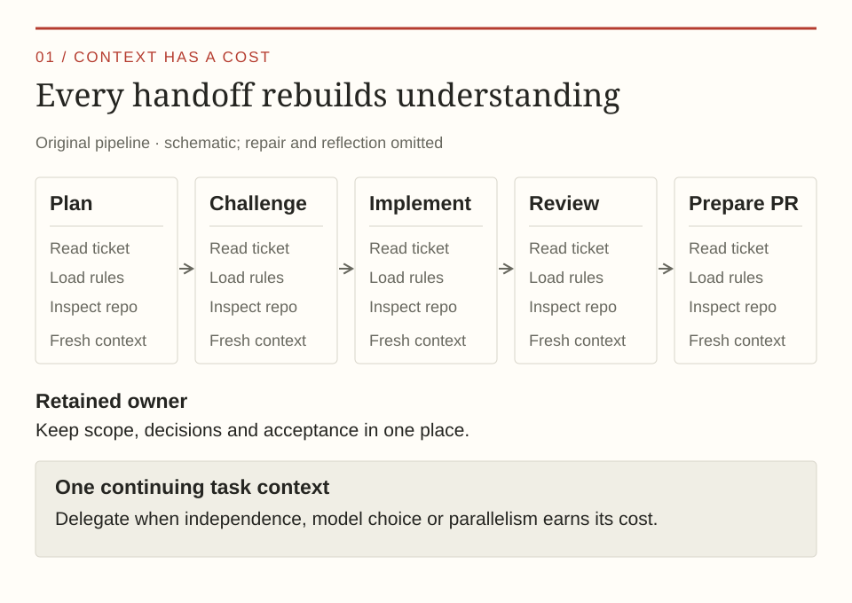
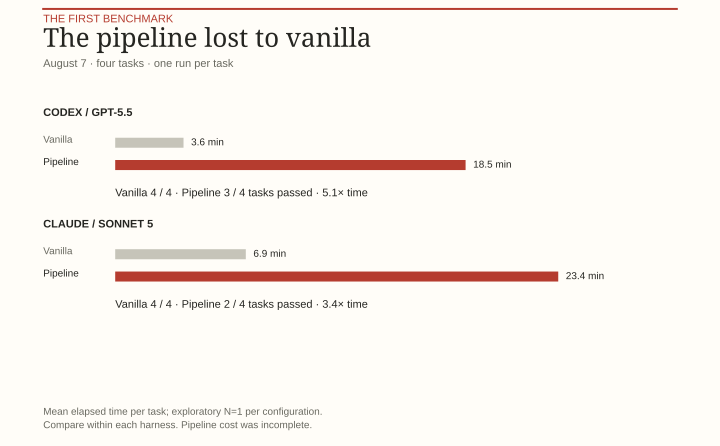
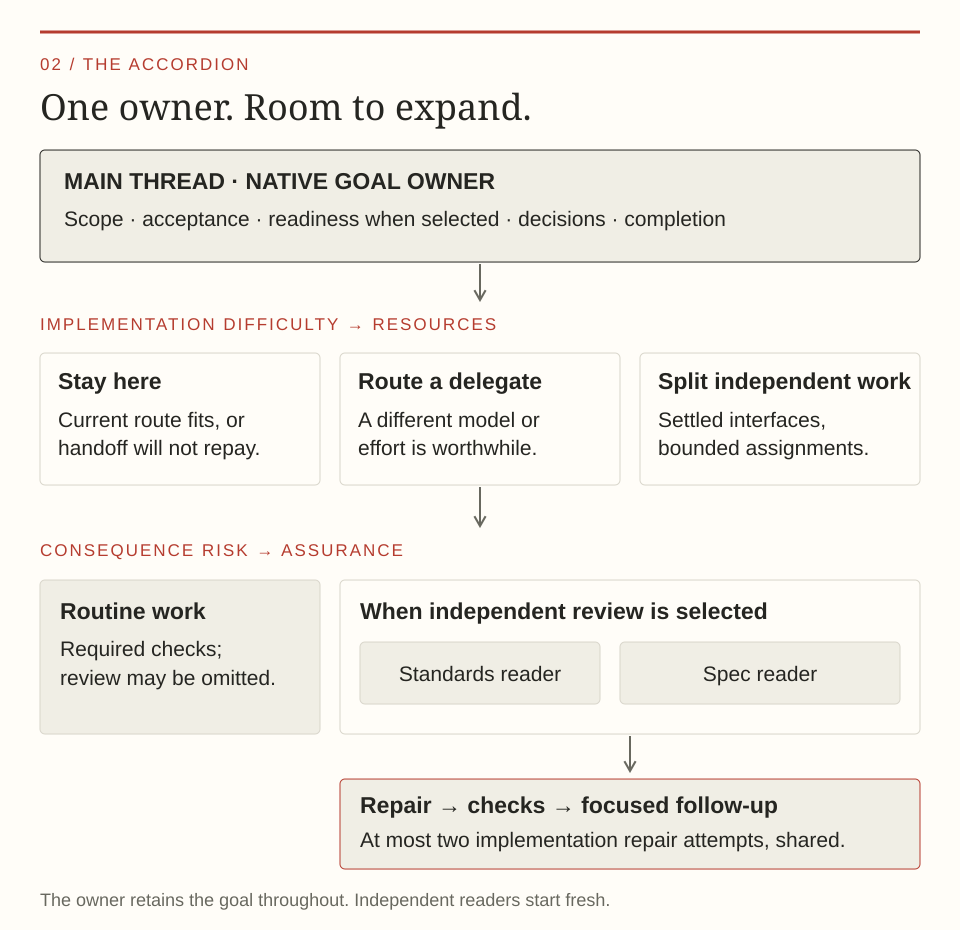
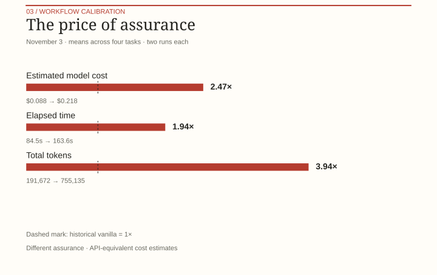
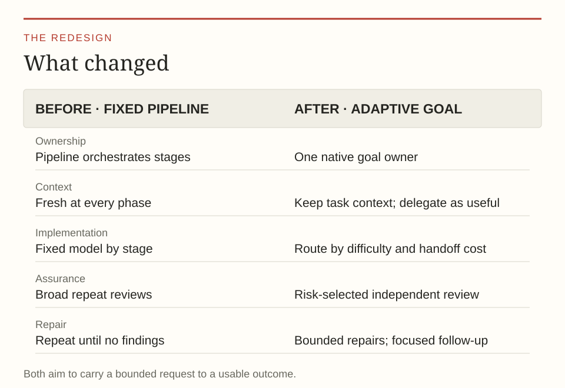

The most uncomfortable benchmark I've run this year was against a prompt that amounted to: implement this ticket.

My carefully constructed pipeline lost. It took longer and failed tasks that the vanilla agent completed. The usage I could account for was expensive, too. All those stages, all that context management, all those specialised subagents. Beaten by asking nicely.

Well, shit.

This is the story of what I kept, what I threw away, and why I still want an orchestration layer in my software factory. I call it **adaptive-goal**. The interesting part is how much of my original orchestrator it no longer needs.

In [Part I](/how-id-build-a-software-factory/), I covered the foundations. In [Part II](/software-factory-part-2-capabilities/), I described capabilities: replaceable procedures for things like reading tickets, practising TDD, and reviewing code. This time, we're moving up to the layer that carries a piece of work through to its intended outcome.

## Recap: How my first orchestrator came to be

At the beginning of the year, I wasn't entirely sure what I wanted to do next. I'd left my job as an engineering manager at a US recruiting startup, where my responsibilities had included infrastructure and product management.

The whole organisation, myself included, had already spent much of 2024 and 2025 working with AI. We'd gone from Copilot to Cursor, added Claude Code when it arrived, and eventually used a mixture of whatever worked best. Then came that late-year jump in capability that many people associate with Opus 4.5. It changed the question I wanted to answer.

Could I build an application with agents writing **all the code**?

I spent January and February finding out. For the application I built, the answer was yes. I still decided what to build, clarified requirements, assessed results, and shaped the environment. But I didn't write the implementation by hand.

By the time I spoke at Agentic Conf Hamburg in March, the setup had become more interesting than the application. [The talk is here](https://www.youtube.com/watch?v=b8ds_VX8kYY).

The core idea was straightforward. Give the main session a well-defined ticket. Let it orchestrate a sequence of specialised subagents: plan, challenge the plan, adjust it, implement, review, repair, reflect on what we'd learned, and prepare a pull request. Each stage got a fresh context. The ticket carried durable state between them.

Ticket in. Pull request out.

I taught this approach to other people. I used it to build other things. At first, I judged it largely by a simple question: **does it get the job done?** In my experience, it did. It delivered useful software, and that mattered enormously to me at the time.

As more people started using this or similar approaches, the cost and inflexibility became harder to ignore. What worked for me on my own projects wasn't necessarily a good fit for a team with different preferences, different tasks, and an AI bill multiplied across its developers.

And once I started looking at this professionally, “it works for me” wasn't enough. I needed evidence: what did the machinery cost, what did it contribute, and how did it compare with just asking the agent to do the work? That's when I started measuring.

## Recap: Every fresh context comes with a bill

The original pipeline applied roughly the same ceremony to every task. A local bug fix went through the machinery just like a change spanning several layers. My first version also ran everything on Opus at the same effort level. Later versions assigned different models and efforts to stages, but those assignments were still fixed.

There was another cost hidden inside what looked like good context hygiene.

Every fresh agent had to orient itself. Read the ticket. Load instructions. Inspect the repository. Find out what the previous agent had done. Write enough back for the next one to continue. I was repeatedly paying to reconstruct understanding that another agent had already acquired.

<figure>
  <picture>
    <source media="(max-width: 600px)" srcset="/assets/images/adaptive-goal-context-tax-mobile.svg" />
    
  </picture>
  <figcaption>The original pipeline repeatedly paid for the same orientation at each handoff.</figcaption>
</figure>

Input tokens became a substantial part of the bill. Caching affects how expensive those tokens are, so token totals alone don't tell the whole story. But the repeated model rounds and handoffs also cost time.

I encountered a related architecture on a client project, with separate coding-agent invocations coordinated through LangGraph. In that setup, phase startup, repeated orientation, and status polling added considerable overhead too. I described one example in the [Sevro post](/sevro-agentic-evals/).

That experience made me increasingly suspicious of phase boundaries. A boundary should buy something: independent judgment, a useful model change, parallel work. “This is the next box in the diagram” wasn't enough.

The pipeline also became awkward to share. As I discussed in Part II, teams have different opinions about reviews, commits, tests, and delivery. Baking all those opinions into one sequence made it harder to replace individual parts.

The away-from-keyboard outcome was still worth keeping. To find a better way there, I needed a benchmark that would challenge the setup.

## Benchmarking my way out of my own assumptions

My first benchmark used my own application. That was a poor choice: weeks of consistent structure, carefully maintained guidance, and familiar patterns had made it unusually easy for agents to navigate. It told me how well the setup worked in an environment I'd prepared for it.

What would happen in codebases that had already seen some shit?

So I assembled a corpus of established open-source projects, pinned to older revisions from before public Copilot availability. The original four-task comparison used [Click](https://github.com/pallets/click), [Ajv](https://github.com/ajv-validator/ajv), [go-git](https://github.com/go-git/go-git), and [Express](https://github.com/expressjs/express). Later experiments added [Requests](https://github.com/psf/requests), [Commander](https://github.com/tj/commander.js), and [Cobra](https://github.com/spf13/cobra). The work covered stream capture, parser error paths, Git URL rewriting, HTTP headers, and other bounded changes.

Old source revisions helped avoid benchmarking only code already shaped around coding agents. They don't prove the models had never seen that code or its eventual fixes during training. This was a practical engineering benchmark, with that limitation.

Each candidate received the same task within a comparison, and I checked the result against defined behaviour and relevant upstream tests. Some experiments also used a condition-blind quality judge. I measured time, usage, and cost where the harness exposed enough information. This tooling eventually became [Sevro](https://github.com/BjRo/sevro).

The baseline stayed deliberately unglamorous: give vanilla Claude Code or Codex the same engineering request and let it work.

The [first four-way comparison](https://github.com/BjRo/darrow/blob/de1809c8bcd2dc29ce8d664fbf4ba8b36a259e89/evals/experiments/orchestration/snapshots/2026-08-07-n1.md) tested vanilla execution, native goal execution, my earlier goal-loop controller, and the static ticket pipeline. There was one trial per task and configuration, so these were exploratory results.

They were still hard to ignore.

On Codex, vanilla and native goal both passed all four tasks. The pipeline passed three and took **5.1 times as long as vanilla**. On Claude, the pipeline passed two of four and took **3.4 times as long**. Complete pipeline dollar costs couldn't be reconstructed, so I can't honestly attach a precise cost multiplier to that experiment.

<figure>
  <picture>
    <source media="(max-width: 600px)" srcset="/assets/images/adaptive-goal-initial-benchmark-mobile.svg" />
    
  </picture>
  <figcaption>The original four-task comparison: mean elapsed time per task and task contracts passed. One trial per task and configuration; compare variants within each harness.</figcaption>
</figure>

> **A note on timing:** Models kept getting better throughout the year. In my experience, Opus 5.5 is far more capable than Opus 4.5, and OpenAI's models have advanced too. A workflow worth building in February may no longer earn its keep later in the year.
>
> Anthropic has since [recommended a single agent with skills for many commerce use cases](https://claude.com/resources/articles/the-anatomy-of-effective-commerce-agents). [The Decoder covered the guidance](https://the-decoder.de/weniger-ist-mehr-anthropic-raet-zum-einzelnen-ki-agent-statt-zu-vielen-subagenten/) in German. That matches much of what I've seen—but it's still worth evaluating your own tasks as the models change.

## The baseline had quietly become an orchestrator

Meanwhile, I was using native `/goal` more and more.

With the capabilities from Part II available, a short request could already ask the agent to read a ticket, prepare a branch, implement with TDD, review the result, and open a PR with green CI.

A native goal gives that request a persistent objective. The agent can bring in the relevant capabilities as it works. I no longer need to manually reconstruct the entire delivery procedure in the prompt.

That already does a surprising amount of what my original orchestrator did.

In the initial benchmark, native goal was close to vanilla on time and passed the same tasks. Across the bounded work I was testing, I couldn't justify isolated planning and implementation stages as a universal default. The agent could often carry the work in one context perfectly well.

I gradually removed my own continuation machinery and based the design on the harness's native goal instead. Today, the main thread retains the objective, acceptance criteria, user decisions, and completion. Subagents get bounded assignments. They don't become replacement owners of the whole delivery.

That ownership matters when I steer the work halfway through. There should be one place that understands the changed request, knows which evidence is now stale, and remembers how many repair attempts have already been used.

But I still wanted my automated away-from-keyboard solution. Damn it.

What should I add around native goal to make that useful?

## An accordion, rather than a fixed procession

The image I keep coming back to is an accordion. It can fold down for small work and expand when the work needs more machinery.

Adaptive-goal makes a few decisions before implementation: is the request ready, how difficult is the implementation, what are the consequences of getting it wrong, and what evidence will establish completion?

Those decisions shape the work. They don't prescribe the same sequence of specialised agents for every ticket.

<figure>
  <picture>
    <source media="(max-width: 600px)" srcset="/assets/images/adaptive-goal-accordion-mobile.svg" />
    
  </picture>
  <figcaption>The accordion expands along two axes: difficulty selects implementation resources; consequence risk selects assurance.</figcaption>
</figure>

### Resolve important uncertainty before implementation

A mandatory file-by-file plan, followed by another agent reviewing it, no longer earns its place in every delivery. I'd rather spend that effort earlier, in a thorough interview while shaping the specification or ticket. People familiar with Matt Pocock's [grilling skill](https://github.com/mattpocock/skills/blob/main/skills/productivity/grilling/SKILL.md) will recognise the idea.

The useful output is acceptance criteria, constraints, test boundaries, and decisions the agent cannot derive from the repository. What happens when data is missing? Which compatibility promise matters? Is changing a public API allowed?

The agent can work out method names and file locations. Existing linters, formatters, and checks should enforce the conventions they can enforce deterministically. I don't need a planning document to restate them.

When selected, the readiness gate checks whether consequential questions remain unresolved. It can stop implementation and send the work back for clarification. Readiness is a replaceable capability; adaptive-goal coordinates the result rather than embedding its own universal definition of a good ticket.

This doesn't eliminate implementation planning. An agent still has to investigate and decide how to approach the code. It removes a mandatory planning ceremony from every delivery.

### Separate difficulty from consequence

These are different questions:

- How hard is this change to implement?
- What happens if we get it wrong?

A small permissions fix might be easy to code and have serious consequences. A broad mechanical refactor might involve many files while leaving little product judgment to invent.

Implementation difficulty helps select the model and effort. Consequence risk helps select assurance. Treating them as one “task size” score would lose a distinction I care about.

Take that permissions fix. The implementation might be local and straightforward, so it doesn't necessarily need the strongest model. But getting permissions wrong can have serious consequences, so I'd still want independent review. For a routine, low-risk change, the main thread might implement it directly and rely on the required checks without a separate review.

The defaults are configurable. So is placement. If the current thread already has the appropriate model and effort, it can implement directly. If the work needs a stronger model, it can delegate on that route. A cheaper model is useful when the savings repay the handoff; for a tiny change, spawning another agent can cost more than simply finishing it.

Independent parts can run concurrently when their interfaces are settled and their edits won't collide. Coupled work stays together. The current design also supports isolated ticket workers and an integration branch, but I don't yet have a comparative benchmark establishing savings from that arrangement.

The goal is useful parallelism, with a reason for each additional agent.

### Keep fresh eyes where they help

The strongest reason I've found to pay for a fresh context is review.

An implementor has spent its context building and defending a particular solution. A separate reviewer gets to approach the change without that history. It can still miss things, of course.

My review capability uses two axes, an idea I borrowed from [Matt Pocock's review workflow](https://github.com/mattpocock/skills/blob/main/skills/engineering/code-review/SKILL.md): **Standards**, which examines the change against repository conventions and engineering concerns, and **Spec**, which checks it against the originating requirements. Applicable readers start independently.

Routine work can omit independent review by default. Risk or an explicit request can require it. If I ask for a delivery with independent review, choosing a cheaper implementation model doesn't get to silently remove that requirement.

This preserves the separation from Part II. My readiness gate and review capability are separate plugins. Adaptive-goal checks which compatible capabilities are available and can select them when the work calls for them; it isn't hard-wired to my particular implementations. A team can bring its own approach. If required assurance isn't available, the goal needs to report that rather than claim it happened.

Adaptive-goal decides what assurance the goal needs. The selected verification and review capabilities own how they provide it.

Risk should also shape the evidence that accompanies a contribution. A small, low-risk change might need a concise explanation and the relevant check results. A higher-risk change could call for more thorough verification and a clearer demonstration of what was changed and why the result can be trusted. Adaptive-goal already considers the evidence needed to complete work; richer, risk-based evidence for the person assessing the contribution is something I want to add later. I haven't built that part yet.

### Put a limit on convergence

“Keep reviewing and fixing until there are no findings” sounds wonderful. I've spent enough time watching it to be less enthusiastic.

A new review can find something the previous one missed. Capable models can also keep discovering increasingly remote edge cases. The implementor fixes them, introduces more machinery, and gives the next reviewer something else to improve. Eventually, it's hard to tell whether we're improving the product or feeding the process.

My default is now one comprehensive assessment, followed by bounded repair. Follow-up verifies the original findings and regressions caused by their repairs. It doesn't open another unrestricted hunt through the codebase.

There are **at most two implementation repair attempts**, shared across findings and assessment providers. A new subagent doesn't reset the counter. Clear evidence ends the loop immediately; unused attempts aren't an invitation to keep working. If required findings remain unresolved, the workflow reports that honestly.

That stopping rule is a trade-off. A consequential change in scope can require broader reassessment. The point is to make that decision explicit instead of accidentally buying an endless series of reviews.

## What the latest numbers actually say

After the initial experiments, I kept working on the overhead. One change let a capable main thread coordinate verification and review directly, while keeping the reviewers independent. That removed coordinator hops without removing fresh eyes.

The [November 3 workflow benchmark](https://github.com/BjRo/darrow/pull/293) tested that updated implementation against archived vanilla controls on four different calibration tasks: a Click bug fix, an Express feature, a helper refactor, and a readiness-skill prose edit. Each task ran twice for the updated implementation. Each task has equal weight in the mean results below.

The task sets and configurations differ from the initial pipeline benchmark, so the two experiments don't measure a direct before-and-after improvement.

<figure>
  <picture>
    <source media="(max-width: 600px)" srcset="/assets/images/adaptive-goal-benchmark-mobile.svg" />
    
  </picture>
  <figcaption>Means across four equally weighted calibration tasks, with two runs per task. Vanilla controls came from the preceding day. Costs are API-equivalent estimates, not subscription charges; the workflows provide different assurance. <strong>These runs covered the engineering work; they didn't include committing, opening a PR, or waiting for CI.</strong></figcaption>
</figure>

Across those tasks, the updated workflow averaged about **two and a half times the estimated dollar cost and twice the elapsed time** of the historical vanilla controls. Those are ratios of the overall mean values, not the overhead for every individual task. The two passes came out at 2.72× and 2.22× the historical vanilla cost. Tokens increased by nearly four times, but many were cached input, so the dollar ratio was lower.

These are exploratory results: four tasks, with two runs each, compared against vanilla controls from the previous day using an earlier runtime profile. The workflows used different levels of assurance, and the dollar figures are estimates based on API pricing. All eight adaptive-goal runs passed their checks, but that doesn't establish equal quality or tell us how these ratios will hold across other work.

Overall, I'm content with where this has landed. I have a feel for the overhead this workflow adds and can explain what I'm getting for it: a delivery process that makes decisions about the work, brings in the capabilities I ask for, and handles selected review and repair without me guiding every step. That also makes it easier to describe the trade-offs to others.

## A primitive for the factory

[Darrow](https://github.com/BjRo/darrow) is my personal playground for software factory ideas. Some of the things I try there might be a bit outlandish for others: using Python for plugin scripting, for example, or researching the effects of requiring 95% or higher code and branch coverage. Exploring those ideas has been immensely useful for wrapping my head around how the pieces of a factory fit together.

[Adaptive-goal is part of Darrow](https://github.com/BjRo/darrow/tree/main/plugins/orchestration/darrow-adaptive-goal). It's useful to me because it packages how I want bounded work carried through delivery: explicit acceptance, selected readiness, deliberate implementation placement, independent assurance where required, and a finite repair budget.

In my Codex setup, I invoke `$adaptive-goal` followed by the delivery request. For example:

```text
$adaptive-goal
Read ticket <TICKET_URL>.
Prepare a branch.
Implement it using TDD.
Review the result independently.
Open a PR and hand it over
with green CI.
```

The request still defines the outcome: implement a change, prepare a pull request, or carry out some other bounded engineering task. The skill supplies the coordination policy around it.

<figure>
  <picture>
    <source media="(max-width: 600px)" srcset="/assets/images/adaptive-goal-before-after-mobile.svg" />
    
  </picture>
  <figcaption>From a fixed procession of stages to an approach that adapts context, implementation, assurance, and repair to the work.</figcaption>
</figure>

The capabilities used inside that process come with their own costs. The more work I ask the agent to do, the more tokens I should expect it to use. A principles-first way of working inspired by [Lauren Tan's (poteto) pstack](https://github.com/cursor/plugins/blob/main/pstack/README.md), for example, asks the agent to load and apply additional engineering guidance. That can be worth paying for, but I wouldn't expect it to be free. The actual cost depends on the work, the models, and what the agent does with those instructions, so I'd measure it against the setup I intend to use.

One of the things I like most about `$adaptive-goal` is that it acts almost like a composable primitive. Let's look at that prompt again:

```text
$adaptive-goal
Read ticket <TICKET_URL>.
Prepare a branch.
Implement it using TDD.
Review the result independently.
Open a PR and hand it over
with green CI.
```

It strings together several intents: read a ticket, prepare a branch, use TDD, review, and open a PR. Available capabilities can provide the procedures behind those instructions.

What happens if I remove a plugin, say the one that teaches my preferred TDD process? Does adaptive-goal need to change? No. If no matching TDD capability is available, the agent can still interpret the request and practise TDD using its own understanding. If a particular capability is explicitly required, though, its absence needs to be reported rather than silently ignored.

That also means I can build different workflows on top of it. If I find myself giving the same delivery request repeatedly, I can package the prompt and its expected input into something like:

```text
$ticket-to-pr <TICKET_URL>
```

That gives me a reusable way to ask for the end-to-end delivery flow while adaptive-goal handles the coordination underneath.

I call those **task recipes**. That's the next layer, and the next post.

:wq
