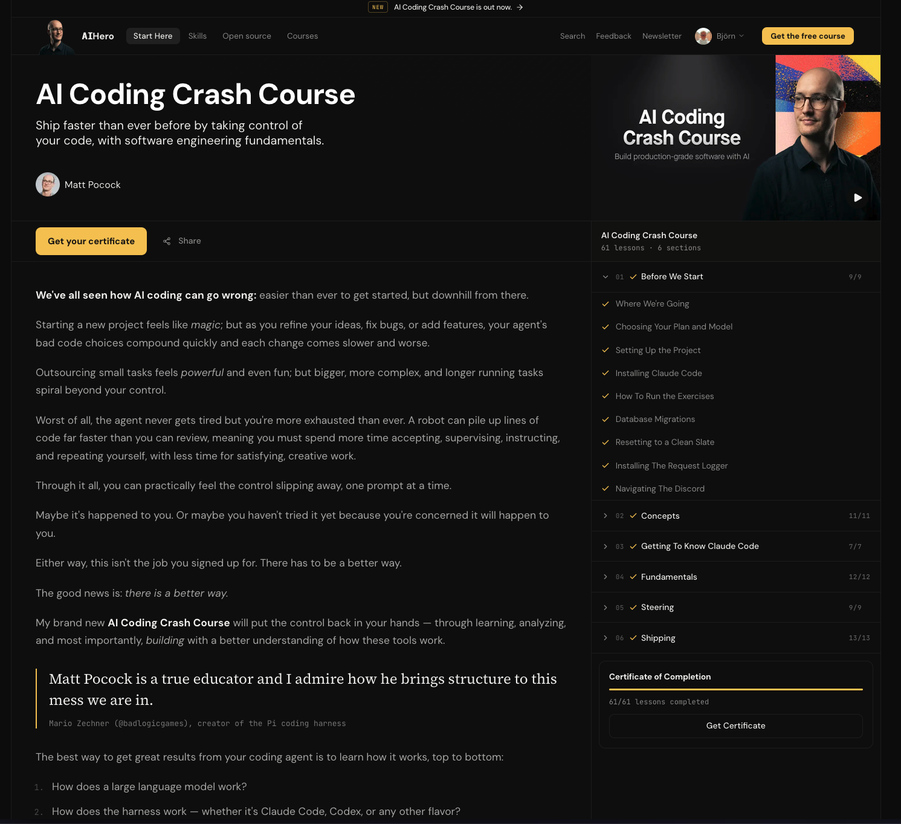
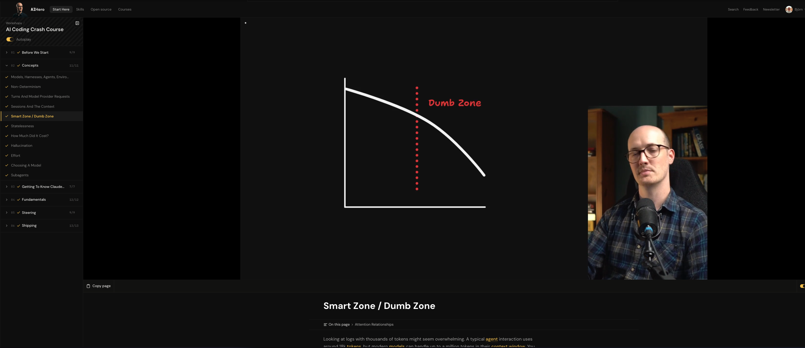
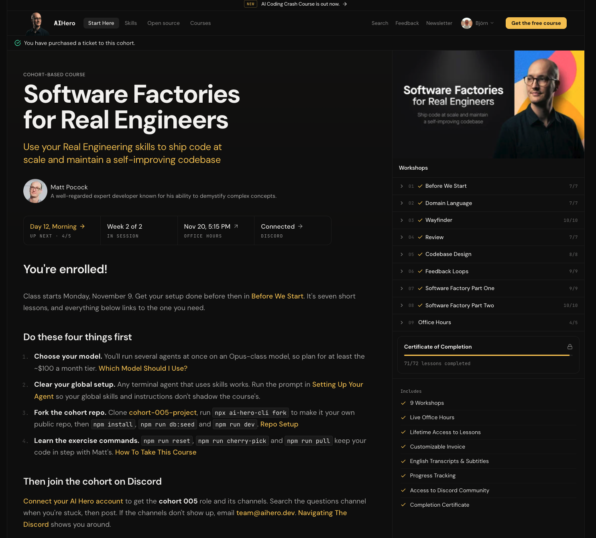
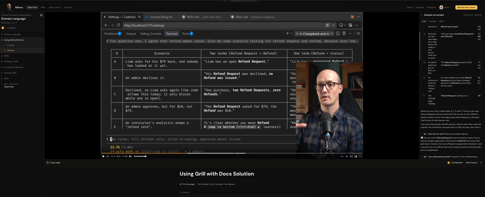

I signed up for Matt Pocock's [Software Factories for Real Engineers](https://www.aihero.dev/cohorts/software-factories-for-real-engineers-xdy1m) course because I wanted to see how someone else had approached a problem I've been working on for most of this year.

I didn't expect to learn quite so much from the [AI Coding Crash Course](https://www.aihero.dev/workshops/ai-coding-crash-course) that came with it.

I've been working with coding agents for a while. I started using Claude Code last years summer, had used Cursor before that, and have now spent more than six months with Codex. This year I went solo to help teams incorporate agentic engineering into their ways of working. I've also taught in-person workshops on software factories.

So I wasn't coming in as a beginner. I wanted to compare notes, see where Matt's thinking differed from mine, and find out what I was missing. It turns out there was a lot in it for me.

The short version is that both courses are excellent. The teaching and preparation are S-tier. I have a few reservations about the factory-specific material, but I would absolutely take the courses again.

## Why I signed up

I'd been hearing good things about Matt for a while. I had also come across his `grill-me` skill, which immediately resonated with me. I've been a big advocate of using agents to interview people during planning. A good interview can uncover uncertainty and edge cases before they become decisions an agent has to make on its own.

That's important to me because I want a predictable way of working. When an agent has to invent an answer without enough guidance, sometimes it gets lucky. Sometimes it doesn't. I'd rather find the important gaps before implementation starts.

At the same time, I had mostly focused on building and evaluating my own skills. I wanted to understand what worked and add the safety nets I felt were missing. That work eventually led to [Sevro](/sevro-agentic-evals/).

Last summer was difficult for my family, and outside of work I had a lot on my mind. But I kept seeing Matt in videos and enjoyed listening to him. He was engaging and precise, and when he announced the cohort, it felt like a good opportunity to spend time learning from someone else. The crash course came as part of the offering. Honestly, I probably wouldn't have signed up for it on its own.

I'm glad I did.

## The format and teaching

As someone who has mostly delivered live, in-person training, I was interested in how Matt structured the courses.

The lessons are available in a self-paced learning environment, with videos, written material, exercises, and solutions. During the cohort, participants also have access to a responsive Discord community and live sessions where Matt answers questions voted on by participants. Recordings are available afterwards.

That mattered to me. I worked through much of the material in the evenings and on weekends, and the recordings meant I could catch up without feeling like I had missed a big part of the experience.

The preparation is obvious. The example application lives on GitHub, with branches for different parts of the training and tooling to reset to a known state or pick up later material. I didn't run into any tooling problems throughout the course. Having recorded training videos myself, I know how much work it takes to make an experience like that feel smooth.

And then there's Matt. He's entertaining to listen to, has a lot of personality, and explains things precisely. I later learned that he had worked as a voice, accent, and public speaking coach before moving into tech. That made a lot of sense.

What impressed me most, though, was the teaching itself. The courses don't just tell you about a concept. They give you a chance to work with it, compare your result to a solution, and understand why the distinction matters.

## The crash course surprised me

<figure>
  
  <figcaption>The AI Coding Crash Course and its six sections.</figcaption>
</figure>

One thing to know before signing up: Matt teaches both general ways of working with agents and how to use his own skills. Those two things are closely intertwined.

He is clearly enthusiastic about what he has built. At times I thought he was raving a little too much about his own skills. It never got to the point of annoying me, though, and having used some of them outside the training, I think he has good reason to be proud. Still, if you don't want to work through someone else's setup, that emphasis may bother you more than it bothered me.

I found it useful to see how a proficient practitioner had put his setup together and to experience it firsthand.

Another concept I had missed was what Matt calls "leading words": terms that carry a lot of meaning for a model in very few tokens. Think of terms such as TDD, tracer bullet, or tautological test. The idea is that the model has encountered these concepts during training and can draw on the associations they carry.

That made me look more closely at how carefully Matt writes his skills. I have often used a skill builder to create mine and then made manual fixes afterwards. Seeing how much he can express with precise, curated wording has made me reconsider that approach. I've noticed a similar attention to wording in Lauren Tan's [pstack skills](https://github.com/cursor/plugins/tree/main/pstack/skills), too.

The crash course also contains the best explanation of agent context I've seen so far. I've read a lot about the subject and seen other people teach it, but Matt makes it unusually easy to understand. His visual explanation and terms such as the "smart zone" and "dumb zone" give you a way to reason about when a long session may start producing worse results.

<figure>
  
  <figcaption>Matt explains the smart zone and dumb zone in the AI Coding Crash Course.</figcaption>
</figure>

A lot of his approach already felt familiar to me. He doesn't expect magic from the tools. He pays attention to context, gives agents ways to check their work, uses deterministic tooling where it can do the job, and works in vertical slices. It was nice to see those ideas presented so clearly, and I won't pretend that having some of my own thinking validated didn't influence how much I enjoyed the course.

But I also picked up ideas I hadn't considered. One was the distinction between a specification ticket and the implementation tickets derived from it. The implementation tickets should be vertical slices (I was already doing this), but also small enough to give the agent a good chance of completing each one while its context is still in the smart zone. 

That gave me another way to think about splitting work. The question isn't only whether a slice delivers something meaningful. It's also whether an agent can keep the relevant information in context while implementing it.

## The advanced course starts with the foundations

The software factory course builds on the crash course. That said, if you expect the entire course to focus on the factory itself, the structure may surprise you. Only two of the eight modules deal directly with the factory, and only one of those is primarily hands-on.

<figure>
  
  <figcaption>The Software Factories for Real Engineers course and its workshop modules.</figcaption>
</figure>

I wonder whether "advanced course" would have been a better title. The material leading up to the factory is where I learned the most.

Matt spends time on domain modelling, codebase design, review, and deterministic controls. This connects closely to something I wrote about in my [previous post on entropy machines](/entropy-machines/). If agents can produce changes faster than a team can inspect them, the environment they work in matters a lot. Tests, code structure, and other constraints help keep that speed useful.

Matt describes this in terms of brakes and accelerators. Accelerators let the agent take on more work. Brakes help keep the quality of that work high. I like that framing, particularly because it's tempting to start with the automation and only later ask whether the codebase can handle it.

### Domain language was my biggest takeaway

The most eye-opening part for me was how much attention Matt pays to shared domain language.

I've used agent-facilitated interviews for a long time, but I hadn't invested enough in establishing the language those interviews use. Watching his approach in action made the gap obvious. When the people involved and the agent use the same terms for the same concepts, the grilling sessions can become much more precise.

One idea I hadn't encountered before was testing names against concrete scenarios. In the `grill-with-docs` exercise, Matt asks the agent to compare using one term for a refund with using separate terms for a refund request and the refund itself. The scenarios include a declined request and someone asking again. With two terms, you can say there were two requests and no refunds. That makes a distinction in the domain much easier to see and discuss before committing to the language.

<figure>
  
  <figcaption>Testing domain terms against scenarios in the Grill with Docs exercise.</figcaption>
</figure>

I can see this being useful well beyond this example. Instead of debating whether a name sounds right, you can see what it lets you express and where it becomes ambiguous.

That was one of those "holy shit, I should have thought about this" moments. For me, that insight alone made the course worthwhile. Domain modelling and shared language were underrepresented in both my training material and my own setup. I want to change that.

### Improving the codebase one constraint at a time

I also enjoyed the material on deep modules, testing through observable interfaces, and improving an existing codebase iteratively. Matt's skills give you concrete ways to start working on a codebase that isn't already in an ideal state.

One idea that stuck with me was applying a ratchet to codebase structure. I'd used the technique before with linters: keep an exclusion list for existing problems, don't allow new entries, and remove entries as you fix them. The codebase can improve without requiring a big cleanup before anyone can move on.

I hadn't thought to apply the same idea to module boundaries and allowed imports. That gives a team a way to move toward a clearer structure in steps. It can also support tests that exercise observable interfaces rather than depending as much on module internals.

And if you read my [last post](/entropy-machines/), you may have noticed that I already put this to work earlier this week. I used Tach to enforce module boundaries in a Python codebase and ratcheted down the existing violations as an agent helped refactor it. A file that had grown beyond 10,000 lines ended up under 3,000, with the test and eval suites still passing. It worked like a charm.

### Wayfinder fills a gap in my workflow

I've long used interviews to clarify individual pieces of work. But sometimes you aren't ready to specify the work yet. You need research, prototypes, and decisions before you can say what should be built.

Matt's Wayfinder skill helps guide that earlier process towards a spec. I had been doing this more ad hoc. Seeing it as an explicit part of the workflow made me realise how much better I could support that stage. I intend to adopt the idea in my own setup.

## The factory itself

The hands-on factory uses GitHub Actions, with stages as separate jobs and GitHub issue labels connecting the transitions. That part resonated with me. I've been exploring label-driven automation in my own setup too, where a component I call the Artificer can start work when a label is applied and account for open pull requests.

I also like that planning happens outside the core implementation loop. Agents can help with that planning, but the factory's core job is to implement and review prepared work. That's close to how I've structured [Adaptive Goal](/software-factory-part-3-adaptive-goal/), even though the details differ.

One choice surprised me, and I'm still thinking about it. In the setup shown in the course, review is a separate step. The reviewer attempts to fix what it can and escalates what it cannot. There isn't a loop that sends review findings back to the implementer for another pass.

My setup uses subagents that can pass information back and forth, so I have taken a different approach. But I don't want to dismiss Matt's choice as merely basic. There is something appealing about a simpler process that covers a lot of cases. I haven't reached a conclusion on which trade-off I prefer.

My main disappointment was the final factory module. It discusses ideas for what you could build and how you could build it, but I would have liked to see Matt continue with his existing setup and implement one of those ideas as a reference. The rest of the courses combine theory, exercises, and solutions so well that this more conceptual section felt like an outlier.

I understand the trade-off. Everyone's factory will look different, and there are many ways to put one together. Still, another concrete example would have helped me connect the ideas to the implementation.

## Would I recommend them?

Yes. The courses were worth the time and money for me, even though I came in with considerable experience and had already explored much of the factory-specific ground.

The crash course gave me a clearer way to explain concepts I already cared about and a new way to think about sizing work for an agent. The advanced course changed where I want to invest next: domain language, gradual improvements to codebase structure, and a more deliberate discovery process before writing a spec.

If you're new to coding agents, the crash course gives you a structured way to learn how they work and practise using them. If you're already experienced, it is still worth considering for the teaching and for a close look at Matt's workflow. For the factory course, go in expecting a substantial amount of advanced engineering practice alongside the factory implementation itself.

I also came away with ideas for my own training. Making complicated concepts easy to understand takes work, and Matt has put a lot of care into it.

Matt, if you ever read this: hats off. I had a blast going through the courses.